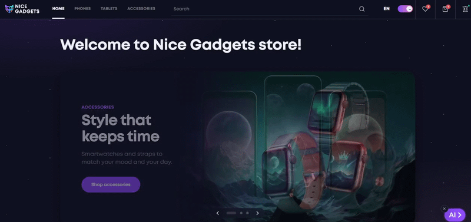
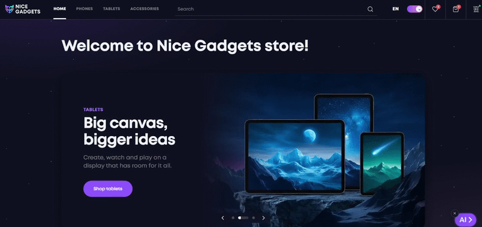

# Nice Gadgets

[**Live demo**](https://gadgets-catalog-swart.vercel.app) · [Documentation](./docs) · [**Developer**](https://gadgets-catalog-swart.vercel.app/developer)





## Features

- Catalog of phones, tablets and accessories with sorting, pagination, price range and other filters
- Product page with a gallery, capacity and color variants, specs and suggested products
- Search with suggestions and a results page
- Cart and favourites that sync to your account after you sign in
- Checkout form with city and branch or postomat search through the Nova Poshta API
- Email sign up and sign in with email confirmation (Supabase Auth, PKCE flow)
- AI assistant that can switch the site language, find a product and compare two or three products
- English and Ukrainian interface, light and dark theme
- Responsive layout from 320px to wide desktop, keyboard focus states and accessible labels

## Engineering highlights

- **Secrets stay on the server.** The AI assistant and the Nova Poshta search go through Vercel serverless functions. They allow only a fixed set of methods, validate every field, check the origin and rate-limit requests, so no API key reaches the browser.
- **Works with or without a backend.** Supabase (Postgres, Auth, row level security) holds products and per-user data. Without it the app falls back to bundled JSON files.
- **Atomic component structure.** Atoms, molecules, organisms, templates and pages, with imports allowed only downwards.
- **Performance work.** Lazy routes, a lazily loaded Supabase client, preloaded route chunks and responsive images with `srcset`.
- **Typed and checked.** Strict TypeScript, ESLint, Prettier, Husky pre-commit hooks and a GitHub Actions check on every pull request.

## Tech stack

- React 18, TypeScript, Vite
- React Router 6 (BrowserRouter), Zustand
- SCSS Modules with shared variables, mixins and theme tokens
- Swiper for sliders, motion for animations
- Supabase for the database and authentication
- Vercel for hosting and serverless functions
- ESLint, Prettier, Husky, lint-staged, GitHub Actions

## Getting started

```bash
git clone https://github.com/AlucardYagamiGame/gadgets-catalog.git
cd gadgets-catalog
npm install
cp .env.example .env
npm run dev
```

The project will open at `http://localhost:5173`.

All environment variables are optional. With an empty `.env` the app uses the bundled JSON data, and the AI assistant and Nova Poshta search do not work. See [Deployment](./docs/DEPLOYMENT.md) for what each variable does.

## Scripts

| Command                | What it does                                   |
| ---------------------- | ---------------------------------------------- |
| `npm run dev`          | dev server                                     |
| `npm run build`        | type check and production build                |
| `npm run preview`      | preview the production build                   |
| `npm run typecheck`    | type check only                                |
| `npm run lint`         | ESLint                                         |
| `npm run format:check` | Prettier check                                 |
| `npm run check`        | types, ESLint, Prettier and build all together |
| `npm run fix-style`    | auto-fix ESLint and Prettier issues            |

## Documentation

- [Architecture](./docs/ARCHITECTURE.md): structure, data flow, state, auth and serverless functions
- [Deployment](./docs/DEPLOYMENT.md): Vercel, environment variables and Supabase settings
- [Development](./docs/DEVELOPMENT.md): code conventions, quality checks and automation

## Roadmap

- Order history for signed-in users
- Password reset and Google sign in
- Tests for filters and hooks, and end-to-end tests for checkout
- Page titles and descriptions per route
- A page about the developer

## Origin

This project started as a team project during my Mate Academy course ([fe-jul26-cherry](https://github.com/fe-jul26-cherry/product_catalog), 4 people), where I was the team lead. This repository is my personal portfolio continuation.

### My contribution

- Technology selection, architecture, atomic component structure, design system and UI kit
- CI/CD, ESLint, Prettier and Husky setup, branching rules, developer documentation
- Supabase integration and email authentication, synced with checkout
- EN/UA language switcher and the light and dark theme redesign
- Catalog filters, URL synchronization, favourites page
- Burger menu, header and category card animations, AI assistant button
- Performance: CLS fixes, faster home page load, product routing refactor to avoid remounting
- Vercel deployment, SEO metrics, rights page
- Jira, task distribution, daily meetings and demos

## Design

[Figma mockup: Phone catalog (V2) Original Dark](https://www.figma.com/design/BUusqCIMAWALqfBahnyIiH/Phone-catalog--V2--Original-Dark?node-id=0-1&p=f&t=ZsJE0PVYtquAgBoJ-0)

[Figma mockup: Phone catalog Original](https://www.figma.com/design/T5ttF21UnT6RRmCQQaZc6L/Phone-catalog--V2--Original?node-id=0-1&p=f&t=MejQW4kIsTQXZ6yr-0)
